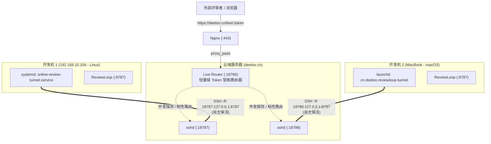

# 案例：多开发机共享单一域名的反向隧道路由（Multi-Tunnel Live Routing）

本文记录了 ReviewLoop 在多开发机环境下的生产部署落地案例：**多台异构开发机（如 Linux 工作站、macOS 笔记本）共享同一个公共公网域名（如 `https://deeloo.cn/live`），各机器自主保活反向隧道，服务端通过智能轻量路由器透明分发。**

---

## 1. 业务场景与痛点

在真实的团队或个人多设备开发场景中：
- **开发机 1（Linux 工作站）**：用于日常后端微服务、AI 工作流开发。
- **开发机 2（macOS 笔记本）**：用于 iOS App（SwiftUI / Xcode）和桌面端应用开发。
- **公共出口**：拥有公网域名与证书的云服务器（如 `deeloo.cn`）。

### 核心痛点
ReviewLoop 的 Live Review 机制采用 AES-256-GCM 加密 Token 与本地快照文件（`~/.config/online-review-feedback/snapshots/`）。
如果云端服务器仅配置单一的反向代理端口（例如 `18787`）：
1. **端口冲突与抢占**：两台机器同时连接时，后连者会抢占或因端口占用失败；
2. **跨机 404**：在 Mac 上执行 `review doc.md` 生成了 URL，但外网 HTTP 请求若被打到 Linux 工作站，由于工作站本地没有 Mac 的快照与解密凭据，会直接返回 404 Not Found；
3. **不同机器前端资源版本差异**：两台机器本地 reviewloop 的 build 产物 hash 可能不同（如 `start.C7U3VyD5.js` 与 `start.BUY851KK.js`），单一切换会导致前端静态资源 404。

---

## 2. 核心架构设计

遵循两个根本原则：
1. **隧道保活由对应机器自己完成**：服务端纯被动监听与路由，不管理任何客户端生命周期；每台机器各自使用本机的系统服务守护工具（Linux systemd、macOS launchd）自主重连自愈。
2. **对 ReviewLoop 核心代码零侵入**：两台机器上的 reviewloop 源码无需任何 hack，基础环境配置统一为 `ONLINE_REVIEW_BASE_URL=https://deeloo.cn/live`。

### 架构拓扑图



---

## 3. 服务端实现：Live Router (:18780)

在云端服务器部署一个仅几十行的原生 Node.js 服务（`live-router.mjs`），监听 `127.0.0.1:18780`：

### 核心路由与分发逻辑
1. **Token 毫秒级探测与缓存**：
   当收到 `/live/:token` 请求时，若缓存未命中，路由器向所有已连接的 upstream 端口（`18787`, `18786` 等）并发发起 HEAD 请求探测。返回 200 的端口即为该 Review 所在的宿主机。探测结果写入 LRU 缓存（TTL 24小时）。
2. **子资源与批注精准投递**：
   后续该 Review 的所有子资源请求（`/live/:token/feedback`、`/live/:token/video`、`/live/:token/image`）直接查缓存代理到目标机器，保障实时批注与 `review feedback` 的双工闭环。
3. **静态资源（`/_app/*`）自适应回退**：
   - 若请求携带 `Referer`，自动提取 Referer 中的 Token 代理到对应机器；
   - 若无 Referer 或版本更新，采用多端级联探测（Waterfall Fallback），确保不同构建版本的 JS/CSS chunk 均能正确返回。

### 云端 systemd 守护配置
`/etc/systemd/system/reviewloop-live-router.service`：
```ini
[Unit]
Description=ReviewLoop Live Multi-Tunnel Router
After=network.target

[Service]
Type=simple
User=ubuntu
WorkingDirectory=/opt/reviewloop
ExecStart=/usr/local/bin/node /opt/reviewloop/live-router.mjs
Restart=always
RestartSec=3

[Install]
WantedBy=multi-user.target
```

### Nginx 反代配置
修改 `/etc/nginx/includes/deeloo.cn/reviewloop.conf`：
```nginx
location ^~ /live/ {
    proxy_pass http://127.0.0.1:18780;
    proxy_http_version 1.1;
    proxy_set_header Upgrade $http_upgrade;
    proxy_set_header Connection "upgrade";
    proxy_set_header Host $host;
    proxy_set_header X-Real-IP $remote_addr;
    proxy_set_header X-Forwarded-For $proxy_add_x_forwarded_for;
    proxy_set_header X-Forwarded-Proto $scheme;
    proxy_connect_timeout 2s;
    proxy_send_timeout 30s;
    proxy_read_timeout 30s;
}

location @live_app {
    proxy_pass http://127.0.0.1:18780;
    proxy_http_version 1.1;
    proxy_set_header Host $host;
    proxy_set_header X-Real-IP $remote_addr;
    proxy_set_header X-Forwarded-For $proxy_add_x_forwarded_for;
    proxy_set_header X-Forwarded-Proto $scheme;
}
```

---

## 4. 客户端自主保活配置

各开发机拥有独立的系统服务，完全自主维持反向隧道。

### 4.1 Linux 开发机（systemd --user）
在 `~/.config/systemd/user/online-review-tunnel.service`：
```ini
[Unit]
Description=Reverse tunnel for live local Markdown review
After=network-online.target online-review.service
Wants=network-online.target online-review.service
StartLimitIntervalSec=0

[Service]
Type=simple
ExecStart=/usr/sbin/ssh -i /home/ldd/pems/deeloo.cn.pem \
    -o BatchMode=yes \
    -o IdentitiesOnly=yes \
    -o ExitOnForwardFailure=yes \
    -o ServerAliveInterval=30 \
    -o ServerAliveCountMax=3 \
    -o TCPKeepAlive=yes \
    -o ConnectTimeout=10 \
    -N -R 127.0.0.1:18787:127.0.0.1:8787 ubuntu@deeloo.cn
Restart=always
RestartSec=5

[Install]
WantedBy=default.target
```

### 4.2 macOS 开发机（launchd）
在 `~/Library/LaunchAgents/cn.deeloo.reviewloop-tunnel.plist`：
```xml
<?xml version="1.0" encoding="UTF-8"?>
<!DOCTYPE plist PUBLIC "-//Apple//DTD PLIST 1.0//EN" "http://www.apple.com/DTDs/PropertyList-1.0.dtd">
<plist version="1.0">
<dict>
    <key>Label</key>
    <string>cn.deeloo.reviewloop-tunnel</string>
    <key>ProgramArguments</key>
    <array>
        <string>/usr/bin/ssh</string>
        <string>-i</string>
        <string>/Users/ldd/.ssh/deeloo.cn.pem</string>
        <string>-o</string>
        <string>BatchMode=yes</string>
        <string>-o</string>
        <string>IdentitiesOnly=yes</string>
        <string>-o</string>
        <string>ExitOnForwardFailure=yes</string>
        <string>-o</string>
        <string>ServerAliveInterval=30</string>
        <string>-o</string>
        <string>ServerAliveCountMax=3</string>
        <string>-o</string>
        <string>TCPKeepAlive=yes</string>
        <string>-o</string>
        <string>ConnectTimeout=10</string>
        <string>-N</string>
        <string>-R</string>
        <string>18786:127.0.0.1:8787</string>
        <string>ubuntu@deeloo.cn</string>
    </array>
    <key>RunAtLoad</key>
    <true/>
    <key>KeepAlive</key>
    <true/>
    <key>StandardOutPath</key>
    <string>/Users/ldd/.config/reviewloop/logs/tunnel.stdout.log</string>
    <key>StandardErrorPath</key>
    <string>/Users/ldd/.config/reviewloop/logs/tunnel.stderr.log</string>
</dict>
</plist>
```

> [!NOTE]
> macOS LaunchAgent 建议将 SSH 密钥放置于 `~/.ssh/` 下，以遵循 macOS 的沙盒及文件系统隐私保护策略。

---

## 5. 生产验证效果

在此架构落地后：
1. **多机并发无冲突**：
   - Linux 开发机发布 Review：输出 `https://deeloo.cn/live/Du5FJqhE`，直接路由至 18787 端口；
   - Mac 开发机发布 Review：输出 `https://deeloo.cn/live/TGsxe2F0`，直接路由至 18786 端口；
   - 两个 URL 均通过公共域名稳定返回 `HTTP/2 200 OK`。
2. **故障隔离**：
   - 任意一台开发机关机、休眠或网络断开，服务端仅对应端口不可达，其他在线节点的 Review 与访问不受任何影响；
   - 机器重新联网后，本地守护进程秒级自愈重新绑定，无需任何人工干预或服务端重启。
